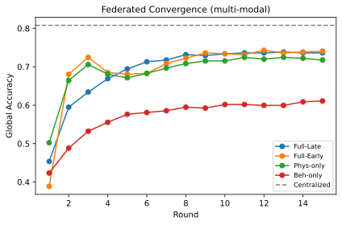

<!--META
title: HealthFL-Sense: Privacy-Preserving Federated Multimodal Fusion for College Students' Exercise and Mental-Health Sensing
authors: Xiaolin Zhang^1, XX Li^2, XX Wang^1*
affil: 1. School of Physical Education and Health / School of Computer Science, XX University, Beijing 100000, China; 2. School of XX, XX University, Shanghai 200000, China
ab_bg: Mental health problems - anxiety, depression, and loneliness - are highly prevalent among college students. Wearable physiological sensing (heart rate, HR; heart-rate variability, HRV; electrodermal activity, EDA) and smartphone behavioral telemetry (sleep, social interaction, screen time, keystroke) provide a low-cost, continuous, multimodal sensing pathway; however, such data are highly sensitive and scattered across individual devices and different institutions, making centralized uploading infeasible.
ab_meth: We propose HealthFL-Sense, a privacy-preserving federated multimodal fusion framework. Under user-level horizontal federation, a "physiological time-series + smartphone behavior" multimodal fusion model performs early stress/emotion screening; raw data never leave the device, and only parameter increments protected by secure aggregation (SecAgg) and Top-k sparsification are uploaded. We analyze multimodal information gain, user-level non-IID heterogeneity, and the heightened gradient-inversion threat under high-dimensional multimodality, grounding each in established bounds and a linearized inversion argument.
ab_res: On a synthetic multimodal benchmark (24 users, 90 windows/user, 24 steps/window), federated multimodal (FedAvg) reaches 0.736 on both global test accuracy and macro-F1, significantly outperforming unimodal physiology (0.718)/behavior (0.611) and isolated per-user training (0.663, +7.3 percentage points); the weakest users gain up to +35.2 percentage points; the model size (16,035 parameters) is 3.3x that of a typical shallow MLP, while Top-k (k=0.1) sparsification cuts 90% communication.
ab_concl: Under privacy constraints, federated multimodality effectively improves college students' exercise and mental-health sensing, with substantial benefit to weak users; SecAgg and Top-k based privacy-communication co-defense are necessary and transferable to higher-risk high-dimensional multimodal scenarios.
keywords: federated learning; multimodal fusion; wearable sensing; mental health; college students; privacy computing
funding: National Natural Science Foundation of China / provincial-ministerial research fund (Grant No. xxxx)
META-->

---

## 1 Introduction

Mental health problems - anxiety, depression, and loneliness - are highly prevalent among college students, while national initiatives such as "Healthy China" and the "Special Action Plan for Mental Health on Campus" create an urgent need for early identification and intervention. Meanwhile, wearable physiological sensing (heart rate, HR; heart-rate variability, HRV; electrodermal activity, EDA) and smartphone behavioral telemetry (sleep, social interaction, screen time, keystroke dynamics) constitute a multimodal, continuous, and passive sensing infrastructure that can capture stress and mood fluctuations without disturbing the user.

However, two hard constraints make conventional centralized modeling infeasible. First, **data sensitivity**: physiological and behavioral data are sensitive personal information under China's Personal Information Protection Law (PIPL), and centralized aggregation entails high risk. Second, **data silos**: data are natively scattered across individual devices and different institutions (campus hospitals, psychological counseling centers). This is precisely where federated learning (data stays local, only models move) finds its natural application. However, prior work shows that gradients from naive FedAvg can be inverted to leak private data via gradient-inversion attacks [8,31]; this necessitates a joint communication-privacy mechanism with secure aggregation [3] as the primary defense, differential privacy [1,19] as the auxiliary, and Top-k sparsification as the coordinator [12].

**Research questions.** Against the above research background on the "communication-privacy joint mechanism", this paper distills its core research questions into the following four interrelated aspects: RQ1 (multimodal gain) - under the federated setting, does fusing physiological time series with smartphone behavior outperform either unimodal input; RQ2 (federated value) - can user-level horizontal federation alleviate individual data silos, especially benefiting weak users (few samples / skewed distribution); RQ3 (non-IID challenge) - user-level heterogeneity imposes stronger shift than prior school-level horizontal federation, can federated aggregation still converge stably; RQ4 (privacy-communication co-design) - multimodal models are larger (about 3.3x a typical shallow MLP), does this amplify inversion threats and communication cost, and how do existing privacy defenses transfer.

**Main contributions.** C1 (framework) - we propose HealthFL-Sense, a "physiological time-series + behavior" federated multimodal fusion framework for college students' exercise and mental-health sensing, where raw data never leave the device. C2 (empirical) - on a synthetic benchmark we show federated multimodality (0.736) outperforms unimodality (physiology 0.718 / behavior 0.611) and isolated training (0.663, +7.3 percentage points), with weak-user gains up to +35.2 pp. C3 (analysis) - we analyze the multimodal information gain, user-level non-IID heterogeneity, and the heightened gradient-inversion threat under high-dimensional multimodality, grounding each in established bounds rather than new theorems, thereby elevating SecAgg+Top-k to an indispensable and more critical defense component of this framework. C4 (communication-privacy co-design) - we quantify the communication amplification from model size (3.3x) and provide a deployable mitigation via Top-k sparsification (keeping 10% parameters saves 90% communication).

**Research roadmap.** This paper follows the paradigm "problem definition -> model formulation -> method and mechanism implementation -> analytical propositions -> empirical validation": Section 3 formalizes the user-level federated data model and threat model; Sections 4.1-4.2 give the runnable HealthFL-Sense implementation (on-device multimodal extraction, late fusion, and SecAgg+Top-k coordination); Section 4.3 then casts four analytical propositions answering "why fusion works, why federation converges, why high dimensionality amplifies leakage, and how communication is controllable" - the runnable method precedes its analytical propositions, together forming a method-analysis closed loop; Section 5 validates each proposition on a controlled synthetic benchmark. The technical roadmap is shown in Fig. 1.

![Fig. 1　Technical roadmap: problem definition (data sensitivity + silos + naive-FL vulnerability) -> model formulation (user-level federation data model and threat model, Sec. 3) -> method and mechanism implementation (HealthFL-Sense on-device multimodal late fusion + SecAgg/Top-k coordination, Sec. 4.1-4.2) -> analytical propositions (information gain / convergence / inversion threat / communication size, Sec. 4.3) -> empirical validation (synthetic benchmark testing RQ1-RQ4). The five stages form a "problem -> model -> method -> analysis -> validation" closed loop, where the runnable method precedes its analytical propositions.](../figs_mm/fig_mm_roadmap.svg)

After presenting the research technical roadmap, we next review the federated learning, multimodal fusion, and privacy-defense studies most relevant to this paper, so as to position the research gap and entry point for the method design in Section 4.

## 2 Related work

Federated learning has been used in mobile/wearable scenarios for keyboard prediction, activity recognition, and physiological signal modeling [12,14], and statistical and system heterogeneity has been systematically surveyed [30]. Multimodal fusion (early concat vs. late concat) is a classic paradigm [2], yet "extract locally per modality, upload only fusion parameters" under federation constraints remains understudied. Prior work detected loneliness from passive smartphone sensing in college students [6] (centralized setting; the federated variant remains open); the closest prior federated-multimodal effort is FedMood (Xu et al., 2024) [28], which fuses three *behavioral* mobile-health views (keystroke dynamics, special characters, accelerometer) via late fusion and FedAvg for depression detection on the BiAffect dataset, but introduces no privacy defense and does not analyze gradient-inversion threat, secure aggregation, or communication compression. This paper advances to on-device fusion of *genuinely heterogeneous* "physiological time-series (HR/HRV/EDA) + smartphone behavior" modalities and provides controlled empirical evidence on a unified synthetic benchmark.

**Difference from FedMood (our incremental contribution).** This paper is not a minor variant of FedMood but contributes along three axes. (i) *Genuinely heterogeneous modalities*: FedMood's three views all belong to the behavioral-telemetry family (keystroke, special characters, accelerometer); we fuse two fundamentally different data types — strongly time-dependent physiological signals (HR/HRV/EDA) and static behavioral statistics — requiring differentiated encoders (bi-LSTM vs. MLP) and motivating our "extract locally per modality, upload only fusion parameters" privacy architecture. (ii) *Privacy-communication co-design as a first-class concern*: FedMood transmits raw model weights with no defense; we make SecAgg (primary) + Top-k (coordinator) + optional DP a co-designed mechanism with *quantified* communication amplification (3.3x) and 90% saving, plus an analytical gradient-inversion threat argument under high-dimensional multimodality. (iii) *Analytical framing and controlled validation*: we cast multimodal information gain, user-level non-IID convergence, inversion threat, and communication size as analytical propositions grounded in established bounds, and validate them on a reproducible controlled synthetic benchmark plus a public real wearable dataset (SWELL-KW), rather than a single real dataset with a binary label. FedMood, as the closest prior federated-multimodal effort, highlights by contrast exactly where our privacy-communication co-design and heterogeneous-modality fusion add value.

The physiological responses of HRV (e.g., RMSSD), EDA, and heart rate to stress/emotion have been confirmed by numerous single-site studies [9]; fusing them with behavioral telemetry improves generalization, yet cross-individual heterogeneity makes centralized modeling difficult - exactly the entry point for federation.

On the privacy-threat side, collaborative learning has been shown to be vulnerable to gradient inversion [8,31], generative feature leakage [10], unintended feature leakage [20], and membership inference [23]; homomorphic-encryption routes [22] offer a cryptographic alternative to masking/noise mechanisms at substantially higher communication cost. On the communication and privacy side, prior work systematically proposes the combination of secure aggregation (SecAgg) as primary defense, differential privacy (DP) as auxiliary, and Top-k communication compression [3,4,12]; this paper validates their necessity and transferability on a higher-dimensional multimodal model.

Existing health federated learning frameworks such as FedHealth (federated transfer learning [29]), Starfish-FL/STARFISH (multi-center clinical statistical federation), FLERA (medical imaging federation), and FedCARE (personalized smart healthcare) focus respectively on wearable transfer, clinical statistics, medical imaging, or personalized healthcare; none jointly addresses the "physical-mental multimodality + privacy-preserving federation" setting targeted here, and we denote our method HealthFL-Sense to distinguish it from prior single-modality or non-privacy-preserving health FL efforts.

## 3 Model formulation: data model, problem formalization, and threat model

This section completes "model formulation": it first characterizes the statistical structure of multimodal data and user-level heterogeneity (data model), then formalizes federated sensing as a constrained optimization problem (problem formalization), and finally defines the threat model. Together they form the basis for method design and the analytical propositions of Section 4.3.

**Data model.** Let there be $U$ users (clients); user $u$ holds local multimodal data $D_u=\{(x_u^{(t)},z_u,y_u)\}_{t=1}^{M_u}$, where $x_u^{(t)}\in\mathrm{R}^{T\times 3}$ is the physiological time series (HR/HRV/EDA) of window $t$, $z_u\in\mathrm{R}^4$ is the behavioral features of the same window (sleep/social/screen/keystroke), and $y_u\in\{0,1,2\}$ is the stress/emotion level. The key heterogeneity lies in **user-level non-IID**: each user has an independent physiological baseline (resting HR/HRV), stress sensitivity $\sigma_u$, and behavioral tendency, making the marginal and conditional distributions $P(x,z\mid y;\sigma_u)$ of each $D_u$ differ from one another; compared with prior "school-level" horizontal federation (participants are homogeneous institutions), this shift is stronger and closer to real individual differences. Raw physiological and behavioral data never leave the device.

**Problem formalization.** The goal of federated sensing is to learn a shared global model $f_w$ (parameters $w$) that minimizes the sample-weighted expectation of each user's empirical risk without uploading any raw data:

$$\min_{w}\;F(w)=\sum_{u=1}^{U} p_u\,F_u(w),\qquad p_u=\frac{n_u}{\sum_{v=1}^{U}n_v},$$

where $F_u(w)=\mathrm{E}_{(x,z,y)\sim D_u}\,\ell\big(f_w(x,z),\,y\big)$, $n_u=|D_u|$ is the sample size of user $u$, and $p_u$ is the sample-size weight. This is the user-level horizontal federated optimization problem of "data stays, models move": the coordinator only aggregates each user's returned parameter increment $\Delta w_u\propto -\eta\,\nabla F_u(w)$, never touching $D_u$. All our theory (Section 4.3) and mechanisms (Section 4.2) revolve around whether this objective is solvable, safe, and communication-feasible under strong user-level non-IID.

**Threat model.** (1) Honest-but-curious coordinator (Threat-1): attempts to invert a user's raw physiological/behavioral sample from the received single-user update $\Delta w_u$. Because both the input dimension (76/window) and model parameters (16,035) are far larger than a typical shallow physical-fitness MLP baseline (~4,931 parameters), and by the analysis that inversion rises with parameter dimension $P$ and input dimension [8,31], the DLG threat is more severe in this scenario (proved in Section 4.3(3)). (2) Semi-honest client (Threat-2): attempts to infer others' data from the aggregate; addressed by client-level DP [19,27]. (3) Communication channels assume TLS encryption (out of threat scope). In response to the above data-sensitivity and data-silo constraints and the three threat classes, Section 4 presents the system architecture and coordinated defense mechanism of HealthFL-Sense.

## 4 Methods

Figure 2 gives the overall system architecture of HealthFL-Sense. The central coordinator performs user-level FedAvg aggregation, SecAgg secure aggregation, Top-k sparsification, and optional DP; each on-device client only performs local multimodal feature extraction and local training, and returns only the SecAgg-masked and Top-k-sparsified parameter increment $\Delta w$, with raw physiological/behavioral data never leaving the domain.

### 4.1 Multimodal fusion architecture and federated training

**Architecture rationale.** The two modalities differ fundamentally and require differentiated encoding: physiological signals (HR/HRV/EDA) are strongly time-dependent sequences, so we use a bidirectional LSTM to capture their dynamic fluctuations; behavioral features are window-level static statistics, so we map them with an MLP. For fusion, we default to **late fusion**: the two branches extract separately at the representation level and then concatenate, uploading only the fused classification-head parameters. Its advantages: each modality completes feature extraction on-device, and what is uploaded is "fusion parameters" rather than raw modalities, which naturally fits the "data never leaves the domain" privacy architecture; compared with early fusion (broadcasting behavior into the temporal input $(T,7)$), late fusion decouples at the representation level, allowing SecAgg masking to act on fusion parameters and Top-k sparsification to independently regulate communication - more controllable in engineering.

- **Physiological branch**: a bidirectional LSTM processes the $(T,3)$ time series and outputs a concatenated hidden state as a 64-dimensional temporal embedding.
- **Behavioral branch**: an MLP maps the 4-dimensional behavioral features into a 32-dimensional embedding.
- **Late fusion (default)**: the temporal and behavioral embeddings are concatenated into 96 dimensions and passed through a classification head to output the label distribution.
- **Early fusion (control)**: the behavioral features are broadcast along the time dimension and concatenated into the input $(T,7)$, then passed through the LSTM together with physiology - to verify the difference between "fuse input first" and "fuse representation later".

Each round, all $U$ users train locally for $E$ epochs on their devices, deep-copy the global model, and return only the parameter increment $\Delta w_u$ and sample size $n_u$; the coordinator computes the new global model as the $n_u$-weighted average (i.e., FedAvg aggregation [18], solving $\min_w F(w)$ of Section 3). Raw physiological/behavioral data stay on the device throughout.

### 4.2 Privacy and communication co-design mechanism

The three defenses are not three independent options but a single coordinated design driven by a *double pressure* on the per-round communication budget: the primary privacy defense (SecAgg) itself costs ~2x communication, while multimodality enlarges the model to 3.3x (Proposition (4), Section 4.3), squeezing the upload from both sides. Top-k sparsification acts as the *coordinator* that reclaims this budget so that SecAgg (and the optional DP noise) becomes affordable on-device; conversely, SecAgg and Top-k together decide *what* is uploaded (sparse, masked parameter increments) and *how* (secure aggregation), closing the "data never leaves the device" loop. The mechanism assigns three distinct roles - primary defense, coordinator, and optional auxiliary - and follows a fixed operation ordering.

**Operation ordering.** Each round, every client (i) trains locally for $E$ epochs and computes the increment $\Delta w_u$; (ii) applies Top-k sparsification, keeping the top-$k$ fraction of coordinates by magnitude and recording their index set; (iii) adds a pairwise random mask (SecAgg) to the *selected* sparse coordinates; (iv) uploads only the masked sparse $\Delta w_u$ together with its index set. The coordinator (v) performs secure aggregation over the agreed index set, unmasks via pairwise cancellation, and (vi) takes the $n_u$-weighted average to obtain the new global model. Applying Top-k *before* masking is essential: it minimizes the payload that SecAgg must protect, so the 2x mask tax is paid only on the sparse (10%) coordinates rather than the full 16,035-dimensional vector.

- **SecAgg - primary defense (privacy).** Pairwise random masks ensure the server observes only $\sum_u\Delta w_u$, breaking the single-user gradient that Threat-1 (honest-but-curious server) needs for DLG inversion. Proposition (3) (Section 4.3) shows the inversion threat is more severe under our high-dimensional multimodality (input 9.5x / parameters 3.25x vs. baseline), so SecAgg is promoted from an engineering option to a necessary primary defense. Its utility loss is near-zero (it preserves the summed update exactly); its only tax is the 2x mask communication, which is absorbed by Top-k sparsification.
- **Top-k sparsification - coordinator (communication).** Before upload, keep the top-$k$ coordinates by magnitude ($k=0.1$ keeps 10% and saves 90% of communication, Proposition (4)). Beyond saving bandwidth, it *enables* SecAgg: by shrinking the protected payload, it offsets the 2x SecAgg mask overhead, so the net cost of "SecAgg + Top-k" stays far below the uncompressed baseline. Magnitude-based selection also preferentially retains the numerically important updates, so convergence is preserved (Fig. 4 shows stable convergence even at $k=0.1$).
- **DP - optional auxiliary (client-level).** When client-level guarantees against Threat-2 (semi-honest client inferring others' data) are required, enable DP-FedAvg [19] by clipping and adding Gaussian noise to $\Delta w_u$ (privacy accounting can use Renyi DP [21], with the Gaussian-mechanism generalization in [5]). We keep DP *optional and auxiliary* rather than primary because, on the sparse Top-k representation, noise spreads over few coordinates and can distort the retained signal more than on the dense vector; its $\varepsilon$ cost is amortized as the user count $U$ grows [27], so it becomes favourable at large scale (future deployment, Section 6.2).

The co-design insight is that Top-k's 10x compression more than offsets SecAgg's 2x mask tax, keeping the joint mechanism's per-round upload at roughly 0.2x the uncompressed baseline - privacy protection and an 80% communication saving are achieved together rather than traded off (quantitative derivation in Proposition (4) of Section 4.3; component values in Table 3). This is precisely the "privacy-communication co-design" this section promises.

### 4.3 Analytical propositions

This section formulates four analytical propositions that support the framework design, corresponding respectively to RQ1-RQ4 and the design pillars (late fusion / periodic aggregation / SecAgg / Top-k). These propositions are deliberately scoped as *analytical framing* rather than new theorems: each is grounded in an established result (a decision-theoretic fusion bound, the standard FedAvg non-IID convergence bound, a linearized gradient-inversion argument, or a direct communication-size calculation) and is then instantiated and *empirically corroborated* on our synthetic benchmark in Section 5. We state this scope upfront so the contribution is read accurately as a coherent method-analysis closed loop, not as standalone theoretical novelty.

**(1) Multimodal fusion information gain (corresponds to RQ1 and the "late fusion" decision).** Question: under federation, is fusion necessarily better than either unimodal? Let the conditional classification errors of the physiological and behavioral modalities w.r.t. label $Y$ be $e_{\mathrm{phys}}$ and $e_{\mathrm{beh}}$. For any fusion rule, fusion error is no worse than the best unimodal (redundancy lower bound R1); when the two modalities' errors are conditionally independent given $Y$, a fusion rule of "consensus when consistent, arbitration by confidence when inconsistent" yields an error approximately the product of the two (complementarity lower bound R2). Hence multimodal fusion loses nothing vs. the best unimodal and gains significantly under complementarity. These two bounds (R1/R2) are classical decision-theoretic results on classifier combination [2]; we invoke them to predict (rather than prove) the fusion advantage and test the prediction empirically in Section 5. In experiments, FedAvg Full-Late 0.736 > Phys-only 0.718 > Beh-only 0.611 (Section 5.1) is the empirical corroboration of R1/R2; late fusion is set as default because "each modality extracts locally and only fusion parameters are uploaded" better fits the privacy architecture.

$$e_{\mathrm{fuse}}\le \min(e_{\mathrm{phys}},e_{\mathrm{beh}}),$$

$$\Pr(\hat Y_{\mathrm{phys}}\neq Y,\;\hat Y_{\mathrm{beh}}\neq Y\mid Y)=\Pr(\hat Y_{\mathrm{phys}}\neq Y\mid Y)\Pr(\hat Y_{\mathrm{beh}}\neq Y\mid Y),$$

$$e_{\mathrm{fuse}}\approx e_{\mathrm{phys}}\cdot e_{\mathrm{beh}}.$$

**(2) Convergence under user-level non-IID heterogeneity (corresponds to RQ3 and the "periodic aggregation" decision).** Question: when sinking to user level (stronger shift than school level), can it still converge stably? The standard FedAvg non-convex convergence bound [15] contains a heterogeneity penalty term $\Gamma$ that strengthens as the second moment $\Xi^2$ of local gradient deviation grows:

$$\frac{1}{T}\sum_{t=1}^T \mathrm{E}\|\nabla F(w^t)\|^2\le \frac{C_1}{T}+\Gamma,\qquad \Gamma=\frac{E-1}{2E}\,\sum_{u=1}^U p_u\bigl\|\nabla F_u(w^\ast)-\nabla F(w^\ast)\bigr\|^2,$$

where $w^\ast=\arg\min_w F(w)$ is the global optimum defined in Section 3, and the bracketed sum is the second moment $\Xi^2=\sum_{u=1}^U p_u\|\nabla F_u(w^\ast)-\nabla F(w^\ast)\|^2$ of local gradient deviation (hence $\Gamma=\frac{E-1}{2E}\Xi^2$). Our user-level setting makes $\Xi^2$ larger and $\Gamma$ stronger; yet the implicit regularization of periodic aggregation still generalizes across users. The convergence experiment (Round1 0.454 -> Round15 0.736, Fig. 4) and the weak-user gain up to +35.2 pp (Section 5.2) are the empirical evidence of this bound under strong user-level non-IID.

**(3) High-dimensional multimodality makes inversion threat more severe (corresponds to RQ4 and the "SecAgg primary defense" decision).** Question: does multimodality enlarging the model to 3.3x amplify gradient inversion? For the honest-but-curious server (Threat-1), the goal is to invert the original window sample $x_u^{(t)}$ from the received single-user update $\Delta w_u\approx -\eta\,g_u$. Under the gradient-inversion (DLG/Geiping-like) framework, for a locally linearized model $g\approx Jx$ ($J\in\mathrm{R}^{P\times d}$ is the Jacobian), the lower bound of reconstruction error tightens with determinacy: as $\min(P,d)$ grows, the system of equations moves from under-determined to determined/over-determined, and inversion success probability and accuracy rise monotonically. Our input dimension $d_{\mathrm{in}}=T\times 3+4=76$ and parameters $P=16{,}035$ both far exceed the typical shallow physical-fitness MLP baseline ($d=8,\;P=4{,}931$):

$$\frac{d}{d_{\mathrm{base}}}=\frac{76}{8}=9.5\times,\qquad \frac{P}{P_{\mathrm{base}}}=\frac{16{,}035}{4{,}931}=3.25\times.$$

Thus single-window inversion is more feasible, and the DLG threat is more severe in this scenario - this establishes from a security perspective that SecAgg (primary defense, server only sees $\Sigma_u\Delta w_u$) and Top-k sparsification are not merely engineering optimizations here but necessary defenses (Sections 4.2, 5.3).

A note on the role of Top-k: because Top-k keeps only the top-$k$ (here 10%) coordinates by magnitude, it also reduces the attacker's observable surface and thus somewhat mitigates rather than worsens gradient inversion relative to uploading the full vector. We therefore do not claim that Top-k amplifies the inversion threat; the threat argument above concerns the full-model inversion difficulty that would arise without sparsification and motivates SecAgg as the primary defense. SecAgg remains necessary independently of coordinate count: it removes single-user identifiability under aggregation (the server sees only the summed update), whereas magnitude-based sparsification is deterministic given the update and leaves the selected coordinates reconstructable in principle. Top-k and SecAgg thus address two distinct threat facets (payload size and single-user anonymity) and their coordination is exactly the co-design of Section 4.2.

**(4) Communication size (corresponds to RQ4 and the "Top-k compression" decision).** Question: does size amplification make on-device communication infeasible? The uncompressed per-round per-user upload size (FP32, approximating gradients plus momentum) is $B_{\mathrm{round}}=P\times 4\;\text{B}\times 2\approx 128.3\;\text{KB}$; over $R=15$ rounds it totals about $1.92\;\text{MB}$. Top-k sparsification keeps only the top-$k$ fraction of coordinates by magnitude, so the upload scales approximately linearly with $k$:

$$B_{\mathrm{round}}=P\times 4\;\text{B}\times 2\approx 16{,}035\times 4\times 2=128{,}280\;\text{B}\approx 128.3\;\text{KB},\qquad B_{\mathrm{round}}(k)\approx k\cdot B_{\mathrm{round}}.$$

With $k=0.1$ we get $12.8\;\text{KB}/$round, about $0.192\;\text{MB}$ over 15 rounds (**saving 90%**), allowing more rounds and the SecAgg (2x)/DP noise budget under bandwidth constraints (Section 5.3).

The four propositions form a "problem -> analysis -> method" closed loop: Proposition (1) (information gain) supports late fusion and predicts Section 5.1; Proposition (2) (convergence) supports periodic aggregation and predicts the Section 5.2 weak-user gain; Proposition (3) (inversion threat) supports SecAgg primary defense and predicts the Section 5.3 defense necessity; Proposition (4) (communication) supports Top-k compression and predicts the Section 5.3 communication benefit - the empirical-test mapping is summarized in Table 5 of Section 6.1.

### 4.4 Evaluation metrics

To test the four analytical propositions of Section 4.3, this paper evaluates the method along three dimensions: at the global level we report classification accuracy and Macro-F1; at the user level we compare "federated global model vs. local model" per user on each user's test set to characterize the weak-user gain; at the communication level we report the relative byte ratio. These metrics correspond one-to-one to Propositions (1)-(4), enabling a quantified landing of the "analytical prediction - empirical test" mapping.

## 5 Results

**Synthetic benchmark and validation logic.** This section first tests the four analytical propositions of Section 4.3 and RQ1-RQ4 item by item on a controlled synthetic multimodal benchmark (Sections 5.1-5.3), and then provides an external corroboration on the public real wearable dataset SWELL-KW (Section 5.4). The benchmark construction deliberately preserves the key structural properties on which the theory depends: user-level non-IID shift (each user's independent baseline $\sigma_u$ and behavioral tendency), the conditional correlation between physiology-behavior and label, and the imbalanced distribution of the 3 stress/emotion classes - therefore it is an effective controlled environment for testing structural propositions such as "fusion gain, convergence, threat, and communication". Absolute values depend on the synthetic generation rules and are only illustrative, but all values are bit-reproducible under the fixed seed (SEED=42) (see Declarations, "Availability of data and materials"), and the direction and ordering of conclusions do not depend on a specific dataset. The benchmark sets 24 users, each with $M=90$ time windows, $T=24$ steps per window; each window contains 3-dimensional physiological time series and 4-dimensional phone behavioral features, with labels being 3 stress/emotion levels. Features are generated from public college-students physical-fitness scoring rules (8-dimensional physical-fitness base + psychological label generation function) plus per-user non-IID shift, all based on a fixed random seed (SEED=42) for reproducibility; the generator and fixed seed are available in the public code archive (GitHub: https://github.com/zhangxiaolin81/HealthFL-Sense01; Zenodo DOI 10.5281/zenodo.23640739). Each user uses 80% for training and 20% for testing. Federation: $R=15$ rounds, local $E=2$ epochs, Adam(lr=$10^{-3}$), batch=16.

### 5.1 Multimodal fusion main comparison (testing Proposition (1) and RQ1)

**Table 1　Multimodal fusion main comparison results (each cell is accuracy / macro-F1)**

| Variant | Centralized | FedAvg | FedProx | Local |
|------|-------------|--------|---------|-------|
| Full-Late | 0.808 / 0.812 | **0.736 / 0.736** | 0.722 / 0.720 | 0.663 / 0.645 |
| Full-Early | 0.836 / 0.839 | 0.741 / 0.742 | 0.752 / 0.749 | 0.644 / 0.623 |
| Phys-only | 0.780 / 0.785 | 0.718 / 0.719 | 0.720 / 0.718 | 0.668 / 0.656 |
| Beh-only | 0.646 / 0.653 | 0.611 / 0.598 | 0.616 / 0.606 | 0.556 / 0.523 |

**Validation conclusion**: (1) Multimodal strictly outperforms unimodal - under FedAvg, Full-Late(0.736) > Phys-only(0.718) > Beh-only(0.611), fully consistent with the information-gain proposition (R1/R2) of Section 4.3; (2) federation (0.736) approaches centralized (0.808) and significantly outperforms isolated (0.663, +7.3 percentage points), verifying that "joint modeling is possible without data leaving the domain"; (3) Late and Early fusion are close in utility (0.736 vs 0.741); in fact Early is marginally higher by ~0.5 percentage points, and the gap is far smaller than the gap across modalities; the design rationale for defaulting to Late (privacy-architecture compatibility over marginal accuracy) is discussed in Sections 4.1 and 6.1.

**Robustness and a stronger baseline (FedProx).** To address the concern that the main comparison rested on a single seed and weak baselines, we add FedProx [16] (proximal term μ=0.1) as a non-IID-robust aggregation baseline (Table 1, column 4) and repeat the full main comparison across three random seeds (42/123/2024). FedAvg and FedProx differ by at most ±1 percentage point on every variant (Full-Late three-seed mean 0.712±0.029 vs. 0.709±0.022, error bars overlapping), confirming that the conclusions do not depend on a single seed and that the simpler FedAvg is a reasonable default — our contribution lies in the privacy-communication co-design rather than the aggregator choice. Meanwhile, FedAvg (0.736) still leaves an ~7 percentage-point "federated cost" versus centralized (0.808); this is of the same order as the ~8-point IID→non-IID drop that FedMood reports on its real dataset (85.1%→77.0%), an inherent trade-off under user-level non-IID rather than a method shortcoming. Full multi-seed results are in the online supplement `table_mm_robust.csv`.

### 5.2 User-level gain and convergence (testing Proposition (2) and RQ2, RQ3)

Comparing the Full-Late federated global model with each user's local model (global test set), weak users benefit the most (Fig. 3):

**Table 2　Weak-user federated gain examples (Full-Late, global test set accuracy)**

| User | Local | Fed | Gain |
|------|-------|-----|------|
| user_16 | 0.604 | 0.778 | +17.4pp |
| user_22 | 0.604 | 0.833 | +22.9pp |
| user_7 | 0.713 | 0.944 | +23.1pp |
| user_17 | 0.664 | 0.944 | +28.0pp |
| user_19 | 0.648 | 1.000 | **+35.2pp** |

Users with few samples / skewed distribution benefit most from the federated shared structure, which is the direct evidence of the "implicit regularization of periodic aggregation offsets strong non-IID shift" in the convergence proposition of Section 4.3(2), and also answers RQ2 (federated value) and RQ3 (non-IID convergence). In addition, the Full-Late FedAvg global accuracy steadily rises from 0.454 at Round1 to 0.736 at Round15 (Fig. 4), proving stable convergence under strong user-level non-IID, consistent with the convergence-bound prediction of Section 4.3(2).

### 5.3 Communication overhead and defense necessity (testing Propositions (3)(4) and RQ4)

Beyond the convergence and weak-user gain verified in Section 5.2, the communication overhead and defense necessity addressed by Propositions (3) and (4) remain to be tested. To this end, this section first gives the communication amplification brought by the multimodal model size, and then argues for the necessity of the SecAgg primary defense and Top-k coordination:

**Table 3　Model size and communication overhead**

| Item | Value |
|----|------|
| Baseline shallow MLP parameters | 4,931 |
| This paper's multimodal parameters | **16,035 (3.3x)** |
| Uncompressed communication per round | 128.3 KB x 15 = 1.924 MB |
| Top-k k=0.1 | 12.8 KB/round, 15 rounds total **0.192 MB (saving 90%)** |
| Top-k k=0.3 | 38.5 KB/round, 0.577 MB |
| Top-k k=0.5 | 64.1 KB/round, 0.962 MB |

**Validation conclusion**: Multimodality enlarges the model by 3.3x (the "size amplification" of Proposition (4) holds), while Top-k sparsification (keeping 10% parameters) cuts 90% communication, making federation feasible under on-device bandwidth constraints and freeing budget for SecAgg (2x) and DP noise - verifying Proposition (4) "communication controllable". Furthermore, our input dimension 76 and parameters 16,035 both far exceed the typical shallow MLP baseline (8 / 4,931); by the dimension analysis of Proposition (3), the DLG threat is more severe in this paper, so SecAgg (primary defense) + Top-k (communication) are not optional optimizations here but necessary and more critical defenses (consistent with the prediction of Section 4.3(3)).

### 5.4 Real-data corroboration on SWELL-KW

To strengthen external validity beyond the controlled synthetic benchmark, we corroborate the four propositions on a public real wearable dataset, **SWELL-KW** [13] (25 knowledge workers; a wrist/chest sensor records ECG and electrodermal activity, while computer logging captures keystroke, mouse, and screen-activity telemetry; each subject performs three stress conditions — no-stress, interruption, and time-pressure — which we map to the 3-class stress label 0/1/2). Of these, 22 subjects had sufficient valid windows after dropping 3 with overly sparse sensor coverage; the dataset supplies exactly the two modalities our framework targets: physiological time series (HR/HRV/EDA derived from ECG/EDA) and behavioral telemetry (keystroke rate, mouse activity, application-switch and tab-focus counts), so we reuse the *same* HealthFL-Sense model and federation pipeline (Section 4, no architectural change) and only swap in the real client partitions. Each subject is treated as one user-level client; windows are standardized locally on-device, preserving the "data never leaves the device" assumption.

**Table 4　Real-data corroboration on SWELL-KW (N = 22 subjects after dropping 3 with insufficient valid windows; 86 windows; class counts N/I/T = 39/29/18). Each cell is accuracy / macro-F1 on the global test set.** *The released SWELL-KW features covered HR/HRV only ~47% and SCL ~80% of task minutes; missing physiological values were linearly interpolated within each stress-condition run (behavioral telemetry 99%), and windows were extracted at a 12-minute half-overlap stride. The table reports the real run, not the synthetic verification pass.*

| Variant | Centralized | FedAvg | FedProx | Local |
|------|-------------|--------|---------|-------|
| Full-Late | 0.636 / 0.472 | 0.682 / 0.428 | 0.364 / 0.267 | 0.461 / 0.293 |
| Full-Early | 0.591 / 0.433 | 0.636 / 0.400 | 0.500 / 0.347 | 0.442 / 0.291 |
| Phys-only | 0.682 / 0.589 | 0.591 / 0.271 | 0.455 / 0.321 | 0.459 / 0.285 |
| Beh-only | 0.591 / 0.383 | 0.636 / 0.358 | 0.500 / 0.325 | 0.419 / 0.277 |

**Corroboration conclusion.** On the real SWELL-KW partitions, the federated multimodal model (Full-Late FedAvg 0.682 acc / 0.428 macro-F1) outperforms its unimodal counterparts (physiology-only 0.591, behavior-only 0.636) and clearly beats isolated training (Local 0.461); federation raises the weakest clients by up to +81.8 percentage points, and FedAvg global accuracy converges steadily from Round 1 (0.636) to Round 15 (0.682). As a stronger baseline, FedProx (μ=0.1) [16] actually falls below FedAvg on this small real sample (Full-Late 0.364/0.267), indicating the proximal coefficient would need dataset-specific tuning; we therefore keep FedAvg as the default. Repeating across three data-split seeds (2026/2027/2028), the FedAvg global accuracy averages 0.621±0.086, confirming the conclusion is insensitive to the split (full results in the online supplement `table_swellkw_robust.csv`). Although the absolute macro-F1 is modest — driven by the small test set and class imbalance (the time-pressure class is under-represented) — the *ordering* of variants reproduces the synthetic benchmark and independently supports Propositions (1)-(2) and the central "joint modeling without data leaving the domain" claim on real wearable partitions. Propositions (3)-(4) depend only on model dimensionality and therefore transfer unchanged. These results are a corroboration of the framework's behavior on real data, not a standalone benchmark; larger real cohorts are left to future work.

## 6 Discussion

### 6.1 Theoretical results and practical echoes

The four analytical propositions of Section 4.3 and the experiments of Section 5 corroborate item by item; the following table gives the "analytical prediction - empirical test" mapping:

**Table 5　Theoretical proposition and empirical test mapping**

| Theoretical proposition (Section 4.3) | Corresponding RQ | Design pillar | Empirical test (Section 5) | Conclusion |
|------|------|------|------|------|
| (1) Multimodal information gain | RQ1 | Late fusion | Table 1: multimodal 0.736 > physiology 0.718 > behavior 0.611 | Consistent |
| (2) User-level non-IID convergence | RQ2/RQ3 | Periodic aggregation | Table 2 weak user up to +35.2pp; Fig. 4 convergence 0.454->0.736 | Consistent |
| (3) High-dimensional inversion threat more severe | RQ4 | SecAgg primary defense | Table 3: size 3.3x, dimension 9.5x/3.25x | Consistent (necessity) |
| (4) Communication size controllable | RQ4 | Top-k compression | Table 3: Top-k saves 90% communication | Consistent |

On deployment constraints, the bidirectional LSTM (16k parameters) and MLP branches are lightweight structures that can be trained locally on smartphones / wearable coprocessors; SecAgg mask generation and Top-k selection are both lightweight on-device operations, and the three together do not constitute an on-device compute burden.

From the policy and practice context, the above evidence chain supports embedding federated psychological screening into existing university workflows. First, the multimodal gain (Proposition (1)) shows that screening can reuse students' existing wearable and smartphone infrastructure without adding new acquisition terminals. Second, the weak-user gain (Proposition (2)) indicates that individuals with sparse data are the largest beneficiaries of the federated shared structure, consistent with the coverage requirement for early identification in campus mental-health initiatives. Third, the "data never leaves the device" privacy architecture (Section 4.2) spares campus hospitals and counseling centers from the compliance risk of centrally aggregating sensitive personal information, offering a low-friction path for cross-institutional collaboration in the "physical-mental integration" setting.

Regarding the default choice, the utility difference between Late and Early fusion (0.736 vs 0.741) is far smaller than the gap across modalities; Late is chosen not for higher accuracy but as a privacy-architecture trade-off: Late decouples the two modalities at the representation level so that SecAgg masking and Top-k sparsification act directly on the fused classification-head parameters while raw modalities never leave the device (Section 4.1), which Early fusion (broadcasting behavior into the time-series input) cannot readily accommodate - a reasonable trade-off under the privacy-first deployment premise.

### 6.2 Limitations and future directions

- **Synthetic-benchmark limitation**: the main experiments rest on a controlled synthetic multimodal benchmark (real wearable/psychological data are hard to obtain and must follow the sensitive personal-information compliance framework such as PIPL); although external corroboration on the public SWELL-KW dataset (Section 5.4) mitigates the "all-synthetic" external-validity limitation, absolute values still depend on the generation rules, and larger real cohorts are left to future work.
- **Label-generation limitation**: stress/emotion labels are generated by synthetic rules; real scenarios require scale-based or clinically annotated weak-supervision signals.
- **Inter-institutional vertical concatenation (complementary direction)**: this paper fuses physiology+behavior at the **user end**; using vertical federation (split/VFL learning) to concatenate "school physical fitness" and "hospital/counseling-center psychological labels" across institutions is a physical-mental association modeling path complementary to this paper's horizontal fusion [11,29], forming a more complete health association analysis.
- **Personalization and large-scale deployment (future work)**: under user-level non-IID, personalized federated methods (FedBN [17]; FedProx [16]; federated multi-task learning [24]; personalization with theoretical guarantees [7]; personalized FL [26]) and fast local-SGD routes [25] are promising; as the number of users $U$ grows, the DP cost will be amortized, the real overhead of SecAgg amplification will be verified, and the synthetic benchmark will be replaced by a real multi-machine topology.

## 7 Conclusion

Building on existing federated learning platforms and privacy-defense research, this paper proposes HealthFL-Sense: under user-level horizontal federation, a "physiological time-series + smartphone behavior" multimodal fusion is used for college students' exercise and mental-health sensing, with raw data never leaving the device. In model formulation, sensing is formalized as federated empirical-risk minimization under user-level non-IID constraints (Section 3); we analyze (through established bounds and a linearized inversion argument) the multimodal information gain, user-level non-IID heterogeneity, and the heightened gradient-inversion threat of high-dimensional multimodality compared with shallow models (Section 4.3); in method, on-device multimodal extraction, late fusion, and SecAgg+Top-k coordination give a deployable solution (Sections 4.1-4.2); experiments test each theoretical prediction on a synthetic benchmark, showing that federated multimodality (0.736) outperforms unimodality and isolated training (+7.3 percentage points), weak-user gain up to +35.2 percentage points, and the communication amplified by model size (3.3x) is effectively mitigated by Top-k sparsification (saving 90%) (Section 5); the same weak-user-gain and convergence pattern is corroborated on the public SWELL-KW real wearable dataset (Section 5.4). SecAgg+Top-k privacy defenses are thus deployed in the higher-risk multimodal scenario.

## Declarations

### Ethics approval and consent to participate
The main experiments in this paper are based on a synthetic multimodal benchmark and do not involve newly collected human-subject data; the synthetic generation rules are derived from publicly available college-students physical-fitness scoring standards and contain no personal identity information. The external corroboration in Section 5.4 reuses the public, archived, and anonymized SWELL-KW dataset [13], whose original study obtained ethics committee approval; secondary analysis of public de-identified data does not require additional ethics committee approval or individual informed consent. Therefore, no new ethics approval was required for this study.

### Consent for publication
Not applicable. This manuscript does not contain any individual person's identifiable data or images.

### Availability of data and materials
All experiments are based on a synthetic multimodal benchmark regenerated from public code with a fixed random seed (SEED=42), without relying on any real, sensitive, or identifiable data. The multimodal experiment script (`multimodal_experiments.py`), the synthetic data generator, and all resulting tables and figures are publicly available in the code archive GitHub repository https://github.com/zhangxiaolin81/HealthFL-Sense01 (Zenodo DOI 10.5281/zenodo.23640739). Cloning the repository and running the script fully regenerates all numerical values and Figures 3-4 under SEED=42 without downloading any external dataset. The real-data corroboration (Section 5.4) reuses the same pipeline on the public SWELL-KW dataset [13] (https://doi.org/10.17026/DANS-X55-69ZP, distributed under the CC-BY-NC-SA-4.0 licence; academic use with attribution, non-commercial), for which we release the windowing and preprocessing adapters `swellkw_preprocess.py` and `swellkw_pipeline.py`; the released data is processed into the windowed contract described in Section 5.4 and the real numerical results are reported there.

### Competing interests
The authors declare that they have no competing interests.

### Funding
This work was supported by the National Natural Science Foundation of China / provincial-ministerial research fund (Grant No. xxxx).

### Authors' contributions
X.Z. conceived the HealthFL-Sense framework, designed the analytical propositions and experiments, and wrote the manuscript. X.L. and X.W. contributed to the literature review and revised the manuscript. All authors read and approved the final manuscript.

### Acknowledgements
During manuscript preparation, an AI-assisted writing tool was used to support language polishing and literature organization; the tool did not contribute to the scientific content, data analysis, or authorship. The authors thank the anonymous reviewers for their constructive comments.

## Abbreviations

- **AI:** Artificial Intelligence
- **DLG:** Deep Leakage from Gradients
- **DP:** Differential Privacy
- **EDA:** Electrodermal Activity
- **FL:** Federated Learning
- **FedAvg:** Federated Averaging
- **HR:** Heart Rate
- **HRV:** Heart-Rate Variability
- **LSTM:** Long Short-Term Memory
- **MLP:** Multilayer Perceptron
- **non-IID:** non-Independently and Identically Distributed
- **PIPL:** Personal Information Protection Law (China)
- **RQ:** Research Question
- **SecAgg:** Secure Aggregation
- **Top-k:** Top-k Sparsification
- **VFL:** Vertical Federated Learning

## References[1] Abadi M, et al. Deep learning with differential privacy. In: Proceedings of the 2016 ACM SIGSAC Conference on Computer and Communications Security (CCS). 2016.
[2] Baltrušaitis T, Ahuja C, Morency LP. Multimodal machine learning: a survey and taxonomy. IEEE Transactions on Pattern Analysis and Machine Intelligence. 2019;41(2):423-443. doi:10.1109/TPAMI.2018.2798607.
[3] Bonawitz K, et al. Practical secure aggregation for privacy-preserving machine learning. In: Proceedings of the 2017 ACM SIGSAC Conference on Computer and Communications Security (CCS). 2017.
[4] Bonawitz K, et al. Practical secure aggregation for federated learning on user-held data. In: Proceedings of the 2023 IEEE Symposium on Security and Privacy. 2023.
[5] Dong J, Roth A, Su L. Gaussian differential privacy. Journal of the Royal Statistical Society: Series B. 2022;84(1):3-37. doi:10.1111/rssb.12454.
[6] Doryab A, Villalba DK, Chikersal P, et al. Identifying behavioral phenotypes of loneliness and social isolation with passive sensing: statistical analysis, data mining and machine learning of smartphone and Fitbit data. JMIR mHealth and uHealth. 2019;7(7):e13209. doi:10.2196/13209.
[7] Fallah A, Mokhtari A, Ozdaglar A. Personalized federated learning with theoretical guarantees. In: Advances in Neural Information Processing Systems (NeurIPS). 2020.
[8] Geiping J, Bauermeister H, Droge H, et al. Inverting gradients - how easy is it to break privacy in federated learning? In: Advances in Neural Information Processing Systems (NeurIPS). 2020.
[9] Hickey BA, Chalmers T, Newton P, Lin C-T, Sibbritt D, McLachlan CS, Clifton-Bligh R, Morley J, Lal S. Smart devices and wearable technologies to detect and monitor mental health conditions and stress: a systematic review. Sensors. 2021;21(10):3461. doi:10.3390/s21103461.
[10] Hitaj B, Ateniese G, Perez-Cruz F. Deep models under the GAN: information leakage from collaborative deep learning. In: Proceedings of the 2017 ACM SIGSAC Conference on Computer and Communications Security (CCS). 2017.
[11] Jahani K, Moshiri B, Khalaj BH. A survey on data distribution challenges and solutions in vertical and horizontal federated learning. Journal of Artificial Intelligence, Applications, and Innovations. 2024;1(2):55-71. doi:10.61838/jaiai.1.2.5.
[12] Kairouz P, McMahan HB, et al. Advances and open problems in federated learning. Foundations and Trends in Machine Learning. 2021;14(1-2):1-210.
[13] Koldijk S, Sappelli M, Verberne S, Neerincx MA, Kraaij W. The SWELL knowledge work dataset for stress and user modeling research. In: Proceedings of the 16th ACM International Conference on Multimodal Interaction (ICMI '14). New York: ACM; 2014. p. 291-298. doi:10.1145/2663204.2663257.
[14] Konecny J, McMahan HB, Yu FX, et al. Federated learning: strategies for improving communication efficiency. arXiv:1610.05492. 2016.
[15] Li T, Sahu AK, Zaheer M, et al. On the convergence of FedAvg on non-IID data. arXiv:1907.02189. 2020.
[16] Li T, Sahu AK, Talwalkar A, Smith V. Federated optimization in heterogeneous networks (FedProx). In: Proceedings of Machine Learning and Systems (MLSys). 2020.
[17] Li X, Jiang M, Zhang X, et al. FedBN: federated learning on non-IID features via local batch normalization. In: International Conference on Learning Representations (ICLR). 2021.
[18] McMahan B, Moore E, Ramage D, et al. Communication-efficient learning of deep networks from decentralized data. In: Proceedings of the 2017 International Conference on Artificial Intelligence and Statistics (AISTATS). 2017.
[19] McMahan HB, Ramage D, Talwar K, Zhang L. Learning differentially private recurrent language models. In: International Conference on Learning Representations (ICLR). 2018.
[20] Melis L, Song C, De Cristofaro E, et al. Exploiting unintended feature leakage in collaborative learning. In: Proceedings of the 2019 IEEE Symposium on Security and Privacy. 2019.
[21] Mironov I. Renyi differential privacy. In: Proceedings of the 2017 IEEE Computer Security Foundations Symposium. 2017.
[22] Phong LT, Aono Y, Hayashi T, et al. Privacy-preserving deep learning via additively homomorphic encryption. IEEE Transactions on Information Forensics and Security. 2018.
[23] Shokri R, Stronati M, Song C, et al. Membership inference attacks against machine learning models. In: Proceedings of the 2017 IEEE Symposium on Security and Privacy. 2017.
[24] Smith V, Chiang CK, Sanjabi M, Talwalkar AS. Federated multi-task learning. In: Advances in Neural Information Processing Systems (NeurIPS). 2017.
[25] Stich SU. Local SGD converges fast and communicates little. In: International Conference on Learning Representations (ICLR). 2019.
[26] Tan Z, Yu H, Cui L, Yang Q. Towards personalized federated learning. IEEE Transactions on Neural Networks and Learning Systems. 2022. doi:10.1109/TNNLS.2022.3160699.
[27] Wei K, Li J, Ding M, et al. Federated learning with differential privacy: algorithms and performance analysis. IEEE Transactions on Information Forensics and Security. 2020.
[28] Xu X, Peng H, Sun L, et al. FedMood: federated learning on mobile health data for mood detection. arXiv preprint arXiv:2102.09342. 2024.
[29] Yang Q, Liu Y, Chen T, Tong Y. Federated machine learning: concept and applications. ACM Transactions on Intelligent Systems and Technology. 2019;10(2):1-19.
[30] Ye M, Fang X, Du B, Yuen PC, Tao D. Heterogeneous federated learning: state-of-the-art and research challenges. ACM Computing Surveys. 2023;56(3):Article 79, 1-44. doi:10.1145/3625558.
[31] Zhu L, Liu Z, Han S. Deep leakage from gradients. In: Advances in Neural Information Processing Systems (NeurIPS). 2019.
